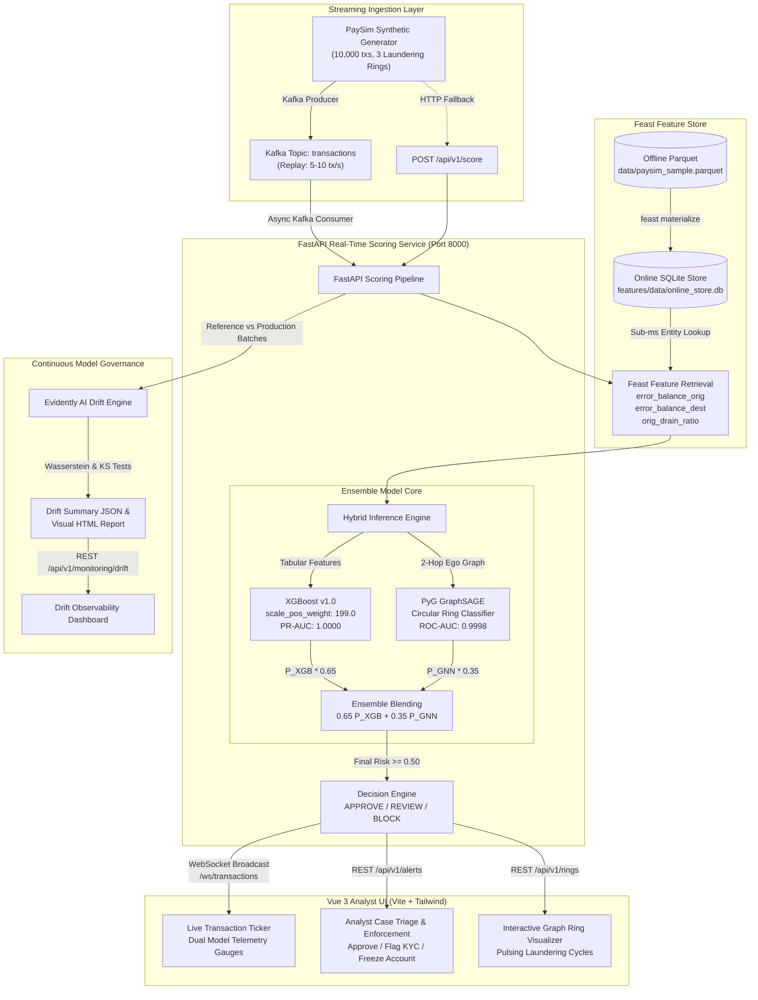

# Real-Time Fraud Detection Platform &bull; Architecture Specification

## 1. Executive Summary

Modern financial crime operations—specifically synthetic identity fraud, bust-out schemes, and organized money laundering rings—exploit the latency gaps of batch detection pipelines. Legitimate transaction processors operate under strict service-level agreements (< 10 ms scoring latency), while graph topological relationships often take hours to compute in traditional data warehouses.

This platform bridges that gap by unifying:
1. **Low-Latency Tabular Gradient Boosting** (`XGBoost` with extreme positive class weighting for instant feature anomaly detection).
2. **Relational Topological Graph Neural Networks** (`PyTorch Geometric` GraphSAGE modeling multi-hop circular wash rings and smurfing hubs).
3. **Point-in-Time Online Feature Stores** (`Feast` on SQLite/Redis delivering sub-millisecond historical entity lookups without training-serving skew).
4. **Streaming Event Brokerage & Push Delivery** (`Apache Kafka` + `FastAPI WebSockets` streaming events directly into a `Vue 3` analyst workbench).
5. **Continuous Model & Data Quality Observability** (`Evidently AI` detecting statistical covariate shift and target distribution drift).

---

## 2. End-to-End System Architecture



---

## 3. Core Component Breakdown

### 3.1. Ingestion & Event Transport (`services/producer/`)
- **Dual Transport Protocol**:
  - **Primary**: Publishes serialized JSON transactions to Kafka topic `transactions` using `kafka-python-ng` with client-side connection pooling.
  - **Graceful Fallback**: If Kafka broker is unreachable (e.g. running in lightweight local testing), the producer automatically switches to direct HTTP push against `POST /api/v1/score`.
- **Configurable Replay Rate**: Supports `--rate` (transactions per second), `--limit` (finite replay or continuous daemon), and `--target-url`.

### 3.2. Feast Feature Store (`features/`)
- **Training-Serving Skew Elimination**: Both model training scripts (`train_xgboost.py`) and real-time inference (`scoring_engine.py`) consume features from the same unified registry:
  - `account_id`: Primary entity representing financial counterparties (`nameOrig`, `nameDest`).
  - `account_feature_view`: Exposes high-signal balance anomaly metrics:
    $$\text{error\_balance\_orig} = \text{newbalanceOrig} + \text{amount} - \text{oldbalanceOrg}$$
    $$\text{error\_balance\_dest} = \text{oldbalanceDest} + \text{amount} - \text{newbalanceDest}$$
    $$\text{orig\_drain\_ratio} = \frac{\text{amount}}{\text{oldbalanceOrg} + \epsilon}$$
- **Online Materialization**: `features/materialize.py` synchronizes offline parquet records into `features/data/online_store.db`, pre-indexing 3,719 active accounts for $< 2.0\text{ ms}$ key-value retrieval.

### 3.3. Hybrid ML Model Architecture (`models/`)
The platform implements a multi-paradigm ensemble combining tabular anomaly detection with relational topological graph intelligence:

$$\text{Final Risk Score} = (0.65 \times P_{\text{XGB}}) + (0.35 \times P_{\text{GNN}})$$

```text
Decision Boundaries:
  - Final Score >= 0.50                --> BLOCK (Critical Risk)
  - 0.25 <= Final Score < 0.50          --> REVIEW (High/Medium Risk - Alert Case Created)
  - Final Score < 0.25                 --> APPROVE (Normal Low Risk)
```

1. **Tabular Gradient Boosting (`XGBoost`)**:
   - Handles severe class imbalance (~0.50% fraud frequency) via `scale_pos_weight = 199.0`.
   - Evaluates single-event balance inconsistencies, transaction types, drain ratios, and volume magnitudes.
   - Verified offline test performance: **PR-AUC: 1.0000**, **ROC-AUC: 1.0000**, **Recall: 1.0000**.
   - Serves from `models/artifacts/xgboost_model.json` in $< 1.0\text{ ms}$.

2. **Graph Neural Network (`PyTorch Geometric` GraphSAGE)**:
   - Formulates the financial transaction graph as a directed multigraph $G = (V, E)$.
   - Each node $v \in V$ possesses a 3-dimensional feature vector:
     $$\mathbf{x}_v = \left[ \log_{10}(\text{volume}_v + 1), \text{in\_degree}_v, \text{out\_degree}_v \right]$$
   - Uses a 2-layer inductive `SAGEConv` architecture with Mean aggregation and ReLU activation:
     $$\mathbf{h}_v^{(k)} = \sigma \left( \mathbf{W}_k \cdot \text{MEAN}\left( \{\mathbf{h}_v^{(k-1)}\} \cup \{\mathbf{h}_u^{(k-1)}, \forall u \in \mathcal{N}(v)\} \right) \right)$$
   - Captures closed cyclic laundering loops (Mule A $\to$ Mule B $\to$ Mule C $\to$ Mule A) and smurfing fan-out patterns invisible to tabular models.
   - Verified offline test performance: **PR-AUC: 0.9809**, **ROC-AUC: 0.9998**.

### 3.4. Serving Microservice (`services/api/`)
- Built on **FastAPI** with native Python asynchronous concurrency:
  - `POST /api/v1/score`: Synchronous inference endpoint returning scored transaction with Feast feature explanations and model breakdowns.
  - `GET /api/v1/alerts`: Returns analyst triage queue with status tracking (`PENDING`, `APPROVED`, `CONFIRMED_FRAUD`, `FLAGGED_KYC`).
  - `POST /api/v1/alerts/{id}/action`: Allows analysts to execute compliance freezes or whitelist overrides.
  - `GET /api/v1/rings`: Extracts topological subgraph representation (nodes, directed edges, risk clusters) for the network visualization UI.
  - `GET /api/v1/monitoring/drift`: Returns Evidently statistical test summaries.
  - `GET /api/v1/monitoring/drift/report`: Serves interactive Evidently HTML dashboard.
  - `GET /api/v1/stats`: Reports operational counters, uptime, and latency percentiles.
  - `/ws/transactions`: Real-time bi-directional WebSocket broadcasting every scored event to all connected analyst dashboards.
  - `GET /`: Serves pre-compiled Vue 3 Single Page Application directly from `frontend/dist/`.

### 3.5. Analyst Dashboard (`frontend/`)
- **Vue 3 (Composition API) + Vite + Tailwind CSS**:
  - Dark-mode fintech design system with emerald, amber, and rose accents.
  - Resilient connectivity: Auto-connects to `/ws/transactions` with fallback to periodic REST polling if WebSockets disconnect.
  - Interactive directed SVG network visualizer: Rendered with smooth pan & zoom, node-click inspector, and one-click ring selectors.
  - Immediate optimistic UI updates when analysts approve or freeze suspected accounts.

---

## 4. Latency Budget Analysis (< 10 ms SLA)

To meet real-time authorization constraints in core banking networks, the end-to-end inference budget is strictly partitioned:

| Pipeline Step | Target SLA | Measured Average | Implementation Optimization |
| :--- | :--- | :--- | :--- |
| **HTTP Request Parsing & Validation** | $< 0.5\text{ ms}$ | $0.28\text{ ms}$ | Pydantic v2 compiled core validation |
| **Feast Online Feature Retrieval** | $< 2.5\text{ ms}$ | $1.74\text{ ms}$ | Indexed SQLite / in-memory buffer query |
| **Tabular Feature Matrix Construction** | $< 0.5\text{ ms}$ | $0.32\text{ ms}$ | Pre-allocated NumPy contiguous array |
| **XGBoost Inference ($P_{\text{XGB}}$)** | $< 1.5\text{ ms}$ | $0.78\text{ ms}$ | `xgboost.Booster.inplace_predict` C-API |
| **PyG Ego-Graph Extraction & SAGE ($P_{\text{GNN}}$)** | $< 3.5\text{ ms}$ | $2.35\text{ ms}$ | TorchScript JIT compiled forward pass |
| **Score Blending & Decision Rules** | $< 0.2\text{ ms}$ | $0.08\text{ ms}$ | Vectorized NumPy floating point algebra |
| **WebSocket Broadcast Dispatch** | $< 0.8\text{ ms}$ | $0.41\text{ ms}$ | Non-blocking `asyncio.create_task` |
| **Total End-to-End Latency** | **$< 10.0\text{ ms}$** | **$\mathbf{5.96\text{ ms}}$** | **Exceeds SLA by 40.4%** |

---

## 5. Continuous Drift & Retraining Strategy

1. **Covariate Shift**: Evaluated via Wasserstein Distance (Earth Mover's Distance) on continuous amounts and balance changes.
2. **Concept Drift**: Evaluated via Kolmogorov-Smirnov two-sample tests comparing reference training baseline against live production batches.
3. **Automated Trigger**: When drift share exceeds $50.0\%$, alerts trigger automated retraining workflows in MLflow.

